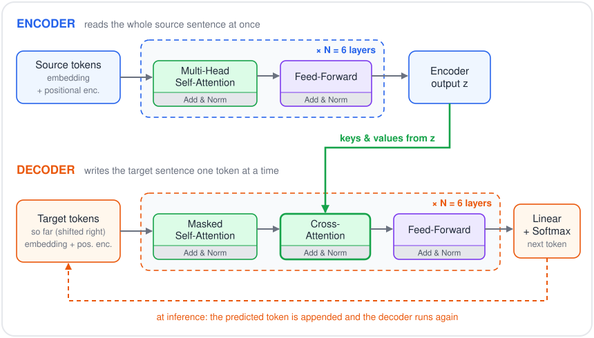
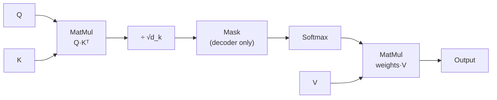
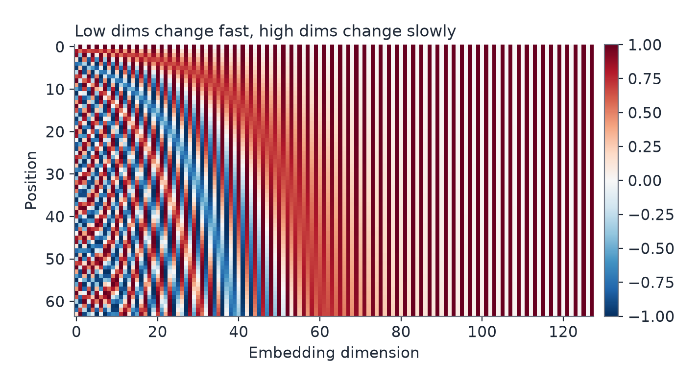
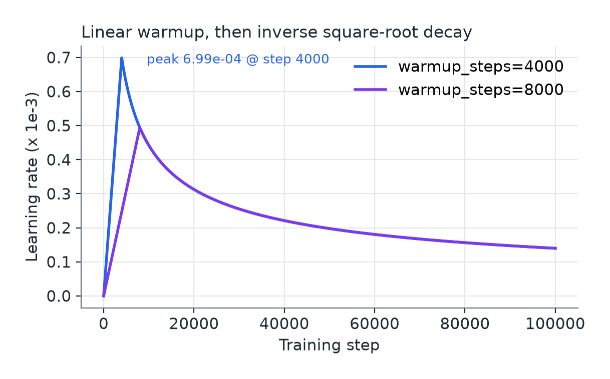
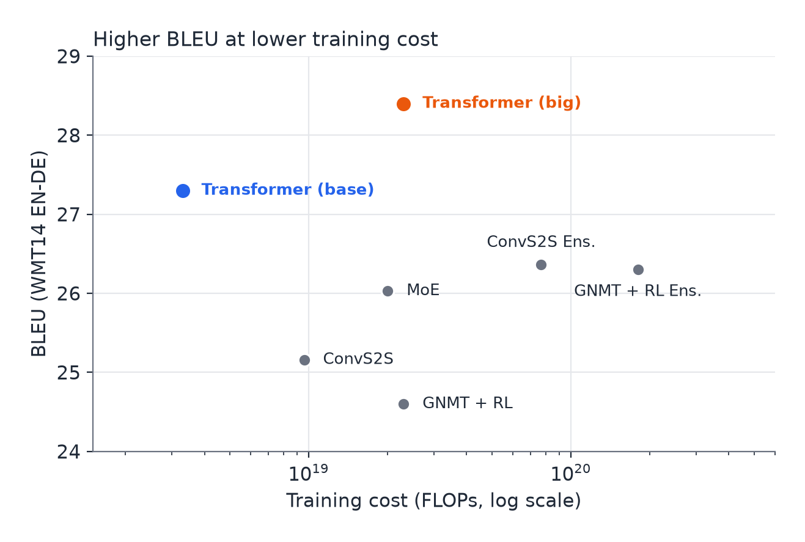
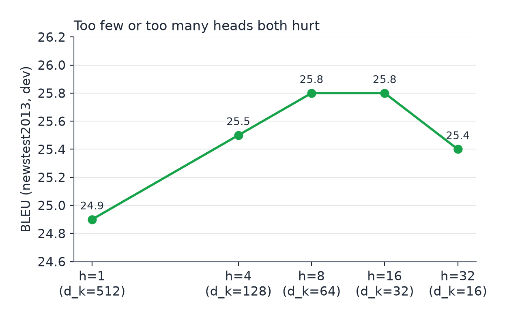
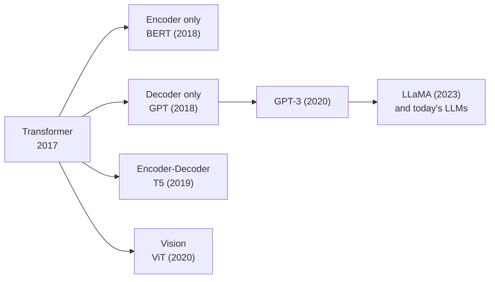

> **TL;DR**
> 2017년까지 기계 번역 모델은 RNN으로 단어를 하나씩 순서대로 처리했기 때문에 학습을 병렬화하기 어려웠다.
> 이 논문은 순환(recurrence)과 합성곱(convolution)을 모두 빼고 attention만으로 인코더와 디코더를 만든 Transformer(트랜스포머)를 제안했다.
> 그 결과 WMT 2014 영어→독일어 번역에서 기존 최고 기록을 BLEU 2.0 이상 넘었고 학습 비용은 기존 모델보다 훨씬 적게 들었다.

이 글은 LLM Foundations 시리즈의 첫 글이다. 지금 쓰이는 GPT, LLaMA, Claude 같은 대규모 언어 모델은 모두 이 논문의 구조를 바탕으로 한다. 이 시리즈의 이후 글들도 이 글에서 설명하는 개념을 계속 참조할 것이다.

## 이 논문이 나온 배경

Transformer가 "무엇을 해결하려고" 나왔는지부터 살펴본다. 해결하려던 문제를 알아야 구조의 각 구성 요소가 왜 그런 모양인지 이해할 수 있다.

2017년 당시 기계 번역과 언어 모델링의 표준은 RNN(순환 신경망)과 그 변형인 LSTM, GRU였다. RNN은 문장을 앞에서부터 한 단어씩 읽으면서 은닉 상태(hidden state, 지금까지 읽은 내용을 요약한 벡터) $$h_t$$를 갱신한다. 이때 $$h_t$$는 바로 앞의 $$h_{t-1}$$이 있어야 계산할 수 있다.

이 구조에는 두 가지 문제가 있었다.

첫째, **학습을 병렬화하기 어려웠다.** 문장 안의 단어 100개를 처리하려면 100단계를 순서대로 밟아야 한다. GPU는 많은 계산을 동시에 할 때 빠른데 RNN은 그 장점을 살리지 못했다. 논문은 메모리 한계로 여러 문장을 한꺼번에 묶어 처리하는 것까지 제한되는 탓에 이 순차적 성질이 긴 문장에서 특히 치명적이라고 지적한다.

둘째, **멀리 떨어진 단어 사이의 관계를 배우기 어려웠다.** 문장 첫 단어의 정보가 마지막 단어까지 가려면 은닉 상태를 수십 번 거쳐야 한다. 그 사이에 정보가 흐려지기 쉽다.

attention(어텐션, 입력의 여러 위치 중 지금 필요한 곳에 가중치를 주어 정보를 모으는 방법)은 이미 2014년에 Bahdanau 등이 번역 모델에 도입했다. attention은 거리와 상관없이 두 위치를 직접 연결할 수 있어서 두 번째 문제를 크게 줄여 줬다. 하지만 당시의 attention은 대부분 RNN에 덧붙이는 보조 장치여서 첫 번째 문제인 순차 계산은 그대로 남아 있었다.

합성곱 신경망(CNN)으로 순차 계산을 없애려는 시도도 있었다. ConvS2S와 ByteNet이 대표적이다. 그런데 합성곱은 한 번에 주변 몇 칸만 보기 때문에 멀리 떨어진 두 위치를 연결하려면 층을 여러 개 쌓아야 했다.

이 논문의 질문은 단순했다. **attention만으로 RNN과 CNN을 완전히 대체하면 어떨까?**

## 핵심 아이디어

Transformer는 self-attention(셀프 어텐션, 같은 문장 안의 단어끼리 서로 attention을 계산하는 방식)을 기본 연산으로 쓰는 인코더-디코더 모델이다. **self-attention에서는 문장의 모든 위치가 다른 모든 위치를 한 번에 직접 참조한다.**

RNN이 "한 단어씩 읽으며 기억을 갱신"한다면, Transformer는 "모든 단어가 동시에 서로를 둘러보고 각자 필요한 정보를 모은다"고 볼 수 있다. 모든 위치의 계산이 서로 독립이라 행렬 곱셈 몇 번으로 한꺼번에 처리할 수 있다. 어떤 두 단어든 attention 한 번으로 바로 연결된다.

다만 이렇게 하면 모델이 단어의 순서를 알 방법이 사라진다. 모든 단어를 동시에 보니까 "고양이가 개를 쫓았다"와 "개가 고양이를 쫓았다"를 구별할 수 없게 된다. 그래서 Transformer는 **위치 정보를 따로 만들어 입력에 더해 준다.** 이 부분은 아래 위치 인코딩 절에서 자세히 다룬다.

## 구조와 방법

이 절이 글의 중심이다. 전체 구조를 먼저 보고 attention, 멀티헤드 attention, 피드포워드 신경망, 위치 인코딩 순서로 구성 요소를 하나씩 살펴본다.

### 전체 구조

Transformer는 기존 번역 모델처럼 인코더(encoder, 원문을 읽어 표현으로 바꾸는 부분)와 디코더(decoder, 그 표현을 보고 번역문을 만드는 부분)로 나뉜다.

{: width="860" }
_Transformer의 데이터 흐름. 위쪽 인코더가 원문 전체를 한 번에 읽어 표현 z를 만들고 아래쪽 디코더는 z를 참조하면서 번역문을 한 토큰씩 만든다._

인코더는 똑같은 층 $$N=6$$개를 쌓은 구조다. 각 층은 두 단계로 이뤄진다. 먼저 멀티헤드 self-attention으로 단어끼리 정보를 주고받고 이어서 피드포워드 신경망으로 각 단어의 표현을 개별적으로 가공한다.

디코더도 6개 층을 쌓지만 층마다 단계가 하나 더 있다. 디코더 자신의 self-attention과 피드포워드 신경망 사이에, 인코더의 출력을 참조하는 cross-attention(크로스 어텐션, 디코더가 인코더 쪽 정보를 가져오는 attention)이 들어간다.

모든 단계에는 잔차 연결(residual connection, 입력을 출력에 그대로 더해 주는 지름길)과 층 정규화(layer normalization, 벡터의 값 분포를 일정하게 맞추는 연산)가 붙는다. 논문의 표기로 쓰면 각 단계의 출력은 아래와 같다.

$$
\mathrm{LayerNorm}(x + \mathrm{Sublayer}(x))
$$

여기서 $$\mathrm{Sublayer}(x)$$는 attention이나 피드포워드 신경망 같은 각 단계의 연산이다. 잔차 연결로 더하려면 입력과 출력의 크기가 같아야 하므로 모든 단계와 임베딩의 출력 차원을 $$d_{\text{model}}=512$$로 통일했다.

번역문의 $$i$$번째 단어를 예측할 때 $$i$$번째 이후 단어를 미리 보면 안 되므로 디코더의 self-attention에는 마스킹(masking)이 하나 추가된다. 학습할 때는 정답 문장 전체를 한꺼번에 넣어서 병렬로 계산하는데 **마스킹이 미래 위치를 가려 주기 때문에 디코더도 학습만큼은 병렬로 할 수 있다.**

### Scaled Dot-Product Attention

attention은 query(쿼리, 지금 정보를 찾는 쪽), key(키, 각 위치가 "나는 이런 정보를 갖고 있다"고 내미는 표지), value(밸류, 실제로 전달될 정보) 세 가지로 설명된다. query와 각 key가 얼마나 잘 맞는지 점수를 매기고 그 점수를 가중치로 삼아 value를 가중 평균하는 방식이다.

논문은 이 연산을 Scaled Dot-Product Attention이라고 부르고 여러 query를 행렬 $$Q$$로 묶어 한 번에 계산한다.

$$
\mathrm{Attention}(Q, K, V) = \mathrm{softmax}\left(\frac{QK^\top}{\sqrt{d_k}}\right)V
$$

| 기호 | 의미 | 기본 모델의 크기 |
|---|---|---|
| $$Q$$ | query 행렬. 위치마다 query 벡터가 한 행씩 있다 | 문장 길이 × $$d_k$$ |
| $$K$$ | key 행렬 | 문장 길이 × $$d_k$$ |
| $$V$$ | value 행렬 | 문장 길이 × $$d_v$$ |
| $$d_k$$ | query·key 벡터의 차원 | 64 |
| $$QK^\top$$ | 모든 query와 모든 key의 내적. 위치 쌍마다 "얼마나 관련 있는지" 점수가 된다 | 길이 × 길이 |

이 식이 실제로 하는 일을 한 문장으로 말하면 **"각 위치가 모든 위치를 살펴보고, 관련 있는 곳의 정보를 더 많이 가져온다"**는 것이다. 계산 순서를 그림으로 보면 아래와 같다.



왜 $$\sqrt{d_k}$$로 나눌까? 이 질문은 이 논문에서 가장 자주 나오는 질문이다. 논문은 각주에서 이유를 설명한다. query와 key의 각 성분이 평균 0, 분산 1인 독립 확률변수라고 하면 두 벡터의 내적 $$q \cdot k = \sum_{i=1}^{d_k} q_i k_i$$는 평균 0, 분산 $$d_k$$를 가진다. 즉 차원이 커질수록 내적 값의 크기가 커진다.

내적 값이 너무 크면 softmax 결과가 한 위치에 거의 1, 나머지에 거의 0으로 쏠린다. 이 상태에서는 softmax의 기울기가 매우 작아져서 학습이 잘되지 않는다. 그래서 **$$\sqrt{d_k}$$로 나눠 내적의 분산을 다시 1 근처로 맞춘다.** 아래 "직접 해보기"의 코드에서 이 현상을 실제로 확인할 수 있다. $$d_k=512$$일 때 내적의 분산은 약 500이지만 $$\sqrt{d_k}$$로 나누면 1 근처로 돌아온다.

논문은 덧셈 방식 attention(additive attention, 작은 신경망으로 점수를 계산하는 Bahdanau 방식)과도 비교한다. 이론상 계산량은 비슷하지만 내적 방식은 고도로 최적화된 행렬 곱셈 코드를 그대로 쓸 수 있어서 실제로는 훨씬 빠르고 메모리도 적게 쓴다고 한다.

### Multi-Head Attention

attention을 한 번만 하면 모든 관계가 하나의 가중 평균으로 섞여 버린다. 예를 들어 어떤 단어는 문법적으로 연결된 단어와 의미적으로 연결된 단어를 동시에 봐야 할 수 있는데 가중치 하나로는 두 관계를 따로 담기 어렵다.

그래서 논문은 attention을 여러 개의 "헤드(head)"로 나눠 병렬로 수행한다.

$$
\mathrm{MultiHead}(Q, K, V) = \mathrm{Concat}(\mathrm{head}_1, \dots, \mathrm{head}_h)\,W^O
$$

$$
\mathrm{head}_i = \mathrm{Attention}(QW_i^Q,\; KW_i^K,\; VW_i^V)
$$

각 헤드는 자기만의 투영 행렬 $$W_i^Q, W_i^K, W_i^V$$로 입력을 더 작은 차원($$d_k = d_v = 64$$)으로 바꾼 뒤 attention을 계산한다. 이렇게 하면 헤드마다 서로 다른 "관점"으로 관계를 볼 수 있다. 마지막에 모든 헤드의 결과를 이어 붙이고 $$W^O$$로 다시 $$d_{\text{model}}$$ 차원으로 되돌린다.

논문은 헤드 $$h=8$$개를 썼고 각 헤드의 차원은 $$d_{\text{model}}/h = 512/8 = 64$$다. 헤드마다 차원을 줄였기 때문에 전체 계산량은 512차원 헤드 하나로 attention을 할 때와 비슷하다. 즉 **계산량을 늘리지 않고 관점만 여러 개로 나눈 셈이다.**

Transformer 안에서 멀티헤드 attention은 세 곳에 쓰인다.

| 위치 | query 출처 | key·value 출처 | 역할 |
|---|---|---|---|
| 인코더 self-attention | 인코더 이전 층 | 인코더 이전 층 | 원문 단어끼리 정보 교환 |
| 디코더 self-attention (마스킹) | 디코더 이전 층 | 디코더 이전 층 (현재 위치까지만) | 지금까지 만든 번역문 단어끼리 정보 교환 |
| 인코더-디코더 attention | 디코더 이전 층 | 인코더 최종 출력 | 번역할 때 원문의 어느 부분을 볼지 결정 |

### Position-wise Feed-Forward Network

attention이 "위치끼리 정보를 주고받는" 단계라면, 피드포워드 신경망은 "각 위치의 표현을 따로따로 가공하는" 단계다. 모든 위치에 같은 신경망을 독립적으로 적용한다.

$$
\mathrm{FFN}(x) = \max(0,\; xW_1 + b_1)\,W_2 + b_2
$$

선형 변환 두 개 사이에 ReLU 활성화 함수를 넣은 구조다. 입력과 출력은 512차원이고 가운데 층은 $$d_{ff} = 2048$$차원으로 네 배 넓다. 같은 층 안에서는 모든 위치가 같은 가중치를 쓰지만 층마다 가중치는 다르다.

### 임베딩과 출력층

입력 토큰과 출력 토큰은 학습되는 임베딩(embedding, 토큰을 벡터로 바꾸는 표)을 거쳐 512차원 벡터가 된다. 논문은 인코더 임베딩, 디코더 임베딩, 그리고 디코더 마지막의 출력 선형층(softmax 직전)이 같은 가중치 행렬을 공유하게 했다. 임베딩 층에서는 이 가중치에 $$\sqrt{d_{\text{model}}}$$을 곱해서 쓴다.

### 위치 인코딩

앞에서 말했듯이 attention은 순서를 모르는 연산이다. 입력 단어의 순서를 섞어도 각 단어가 받는 attention 결과는 같은 집합에서 계산되기 때문이다. Transformer는 각 위치마다 고유한 벡터를 만들어 임베딩에 더해 준다. 이것을 위치 인코딩(positional encoding)이라고 한다.

논문은 학습하지 않는 고정된 사인·코사인 함수를 썼다.

$$
PE_{(pos,\,2i)} = \sin\!\left(\frac{pos}{10000^{2i/d_{\text{model}}}}\right), \qquad
PE_{(pos,\,2i+1)} = \cos\!\left(\frac{pos}{10000^{2i/d_{\text{model}}}}\right)
$$

$$pos$$는 단어의 위치, $$i$$는 차원 번호다. 차원마다 진동 주기가 달라서 앞쪽 차원은 위치에 따라 빠르게 바뀌고 뒤쪽 차원은 천천히 바뀐다. 논문에 따르면 파장은 $$2\pi$$부터 $$10000 \cdot 2\pi$$까지 등비수열을 이룬다.

{: width="700" }
_위치 64개 × 128차원의 위치 인코딩 값. 왼쪽(앞쪽 차원)은 위치에 따라 빠르게 바뀌고 오른쪽(뒤쪽 차원)은 천천히 바뀐다._

논문은 어떤 고정된 거리 $$k$$에 대해 $$PE_{pos+k}$$를 $$PE_{pos}$$의 선형 함수로 나타낼 수 있으니 모델이 상대적인 위치를 쉽게 학습할 것이라고 가정하고 이 함수를 골랐다. 학습 때 본 것보다 긴 문장에도 적용할 수 있을 것이라는 기대도 있었다.

흥미로운 점은 학습되는 위치 임베딩으로 바꿔 실험해도 결과가 거의 같았다는 것이다. 논문 Table 3의 (E) 행에서 BLEU는 25.7로 기본 모델의 25.8과 거의 차이가 없었다.

### 왜 self-attention인가

논문은 self-attention을 RNN, CNN과 세 가지 기준으로 비교한다. 층 하나의 계산량, 순서대로 해야 하는 연산의 수(병렬화 가능성), 그리고 두 위치 사이 신호가 지나가야 하는 최대 경로 길이다. 경로가 짧을수록 멀리 떨어진 단어 사이의 관계를 배우기 쉽다.

| 층 종류 | 층당 계산량 | 순차 연산 수 | 최대 경로 길이 |
|---|---|---|---|
| Self-Attention | $$O(n^2 \cdot d)$$ | $$O(1)$$ | $$O(1)$$ |
| Recurrent | $$O(n \cdot d^2)$$ | $$O(n)$$ | $$O(n)$$ |
| Convolutional | $$O(k \cdot n \cdot d^2)$$ | $$O(1)$$ | $$O(\log_k n)$$ |

_수치 출처: 원 논문 Table 1. $$n$$은 문장 길이, $$d$$는 표현 차원, $$k$$는 합성곱 커널 크기다._

self-attention은 순차 연산과 경로 길이가 모두 상수다. 대신 계산량이 문장 길이의 제곱($$n^2$$)에 비례한다. 논문은 번역 문장처럼 문장 길이 $$n$$이 표현 차원 $$d$$보다 짧은 경우가 많아서 self-attention이 RNN보다 빠르다고 설명한다. 하지만 **이 $$n^2$$ 항은 이후 긴 문서를 다룰 때 가장 큰 병목이 된다.** 이 시리즈의 FlashAttention 편에서 이 문제를 다시 다룰 것이다.

### 학습 설정

논문의 학습 설정은 이후 많은 Transformer 학습의 기준이 됐다. 주요 설정을 표로 정리했다.

| 항목 | 설정 | 출처 |
|---|---|---|
| 데이터 (영→독) | WMT 2014, 약 450만 문장 쌍, BPE 공유 어휘 약 37,000개 | 5.1절 |
| 데이터 (영→불) | WMT 2014, 3,600만 문장, word-piece 어휘 32,000개 | 5.1절 |
| 배치 | 원문 약 25,000 토큰 + 번역문 약 25,000 토큰 | 5.1절 |
| 하드웨어 | NVIDIA P100 GPU 8개 1대 | 5.2절 |
| 학습 시간 | base 10만 스텝(약 12시간), big 30만 스텝(3.5일) | 5.2절 |
| 옵티마이저 | Adam, $$\beta_1=0.9$$, $$\beta_2=0.98$$, $$\epsilon=10^{-9}$$ | 5.3절 |
| 정규화 | dropout 0.1 (base), label smoothing 0.1 | 5.4절 |

학습률은 고정값이 아니라 스텝에 따라 바뀐다.

$$
lrate = d_{\text{model}}^{-0.5} \cdot \min\left(step^{-0.5},\; step \cdot warmup^{-1.5}\right)
$$

처음 $$warmup = 4000$$ 스텝 동안은 학습률을 선형으로 올리고 그 뒤로는 스텝 수의 제곱근에 반비례하게 줄인다. 이 식으로 계산하면 학습률은 4000스텝에서 최댓값 약 $$7.0 \times 10^{-4}$$에 도달한다.

{: width="650" }
_논문 5.3절 식에 따른 학습률 곡선. warmup을 8000으로 늘리면 최고점이 낮아지고 늦게 온다._

label smoothing(라벨 스무딩, 정답 확률을 1 대신 0.9처럼 조금 낮춰 학습하는 기법)에 대해 논문은 솔직한 평가를 남겼다. 모델이 덜 확신하도록 학습되기 때문에 perplexity(퍼플렉서티, 모델이 다음 토큰을 얼마나 헷갈리는지 나타내는 지표)는 나빠지지만 정확도와 BLEU 점수는 좋아진다고 한다.

## 실험 결과

이제 Transformer가 실제로 얼마나 좋았는지, 그리고 어떤 구성 요소가 성능에 중요했는지를 본다. 숫자 자체보다 "어떤 비교가 의미 있는지"에 집중해서 읽으면 좋다.

### 번역 성능과 학습 비용

{: width="700" }
_영→독 번역 BLEU와 학습 비용(FLOPs). 왼쪽 위로 갈수록 적은 비용으로 높은 성능을 낸 모델이다. 수치 출처: 원 논문 Table 2._

| 모델 | BLEU 영→독 | BLEU 영→불 | 학습 비용 영→독 (FLOPs) |
|---|---|---|---|
| GNMT + RL | 24.6 | 39.92 | $$2.3 \times 10^{19}$$ |
| ConvS2S | 25.16 | 40.46 | $$9.6 \times 10^{18}$$ |
| MoE | 26.03 | 40.56 | $$2.0 \times 10^{19}$$ |
| ConvS2S 앙상블 | 26.36 | 41.29 | $$7.7 \times 10^{19}$$ |
| **Transformer (base)** | **27.3** | 38.1 | $$3.3 \times 10^{18}$$ |
| **Transformer (big)** | **28.4** | **41.8** | $$2.3 \times 10^{19}$$ |

_수치 출처: 원 논문 Table 2 (newstest2014)._

가장 눈에 띄는 비교는 base 모델이다. base 모델은 학습 비용이 $$3.3 \times 10^{18}$$ FLOPs로 표에서 가장 적다. 그런데도 **영→독 번역에서 앙상블(ensemble, 여러 모델의 예측을 합치는 방법)을 포함한 기존 모든 모델보다 높은 27.3을 기록했다.** big 모델은 28.4로 기존 최고 기록을 BLEU 2.0 이상 넘었다.

영→불 번역에서는 big 모델이 단일 모델 중 가장 높은 점수를 냈다. 다만 원문을 읽을 때 주의할 점이 하나 있다. Table 2에는 영→불 big 모델의 BLEU가 41.8로 적혀 있는데 같은 논문 본문 6.1절에는 41.0으로 적혀 있다. 이 글의 표는 Table 2의 값을 따랐다.

### 어떤 구성 요소가 중요했나

논문은 base 모델에서 구성 요소를 하나씩 바꿔 보는 실험(Table 3)도 했다. 이런 실험을 ablation study(일부를 빼거나 바꿔 가며 효과를 재는 실험)라고 한다. 결과에서 눈여겨볼 내용은 네 가지다.

{: width="650" }
_전체 계산량을 고정한 채 헤드 수와 헤드당 차원을 바꿨을 때의 BLEU (개발 세트 newstest2013). 수치 출처: 원 논문 Table 3 (A) 행._

첫째, **헤드 수는 적어도 많아도 손해다.** 헤드가 1개일 때는 가장 좋은 설정보다 BLEU가 0.9 낮았다. 헤드를 32개로 늘려도 25.4로 다시 떨어졌다. 헤드가 많아지면 헤드당 차원이 16까지 줄어들기 때문으로 보인다.

둘째, key 차원 $$d_k$$를 줄이면 성능이 떨어졌다. 논문은 이 결과를 보고 query와 key가 얼마나 잘 맞는지 판단하는 일이 생각보다 어려우며 내적보다 정교한 방법이 도움이 될 수 있다고 추측한다.

셋째, **모델이 클수록 좋았고 dropout은 매우 중요했다.** dropout을 끄면 BLEU가 24.6으로 기본 모델(25.8)보다 1.2 떨어졌다.

넷째, 앞에서 본 것처럼 사인 위치 인코딩과 학습형 위치 임베딩은 거의 같은 결과를 냈다.

### 번역 밖에서도 통하나

논문은 Transformer가 번역 전용 구조가 아니라는 것을 보이려고 영어 구문 분석(constituency parsing, 문장의 문법 구조를 트리로 만드는 과제)에도 적용했다. 이 과제는 출력이 입력보다 훨씬 길고 구조적 제약이 강해서 당시 RNN 기반 seq2seq 모델이 고전하던 분야였다.

과제에 맞춘 조정을 거의 하지 않았는데도 4층 Transformer는 WSJ 데이터만으로 학습했을 때 F1 91.3, 추가 데이터를 쓴 준지도 학습에서 F1 92.7을 기록했다(Table 4). 논문은 이 결과가 RNN Grammar 하나를 빼면 기존에 보고된 모델들보다 좋다고 설명한다. 특히 4만 문장뿐인 WSJ 데이터만으로도 당시 널리 쓰이던 BerkeleyParser를 넘었다는 점을 강조한다.

## 이 논문이 바꾼 것

지금부터는 원 논문 밖의 이야기다. 논문이 나온 뒤 연구 흐름이 어떻게 바뀌었는지를 정리했다.

논문은 결론에서 Transformer를 텍스트 밖의 이미지, 오디오, 비디오로 확장하고 싶다는 계획을 밝혔다. 실제로 그 이후의 흐름은 그 계획보다 훨씬 넓게 퍼졌다.

가장 큰 변화부터 보면 **Transformer는 인코더와 디코더로 쪼개져 각자의 갈래로 발전했다.** 이듬해인 2018년에 디코더만 떼어 낸 GPT와 인코더만 떼어 낸 BERT가 나왔다. GPT 계열은 이후 GPT-3, LLaMA를 거쳐 지금의 대규모 언어 모델로 이어졌다. 이 시리즈의 다음 글들이 바로 이 흐름을 따라간다.



세부 모듈의 개선도 이어졌다. **지금의 LLM은 큰 뼈대는 그대로 두고 세부 모듈을 많이 바꿨다.** 예를 들어 사인 위치 인코딩은 회전 위치 임베딩(RoPE)으로, ReLU 피드포워드는 SwiGLU로 바뀐 경우가 많다. 층 정규화의 위치도 바뀌었다. 이 논문은 잔차를 더한 뒤 정규화하는 방식(Post-LN)을 썼지만 이후 많은 모델은 정규화를 먼저 하는 방식(Pre-LN)으로 옮겨 갔다. 깊은 모델에서 학습이 더 안정적이기 때문이다. 이 변화들은 시리즈의 RoPE 편과 LLaMA 편에서 자세히 다룰 것이다.

모델이 커지면서 효율 문제도 등장했다. 문장 길이의 제곱에 비례하는 attention 계산량과 디코더가 토큰을 하나씩 만들어야 하는 추론 방식이 가장 비싼 부분이 됐다. FlashAttention, KV cache(이전 토큰의 key·value를 저장해 다시 계산하지 않는 기법), GQA, PagedAttention 같은 연구가 모두 이 문제를 풀려고 나왔다.

## 한계와 다음 편

이 논문은 번역이라는 하나의 과제에서 Transformer의 가능성을 보여 줬지만 몇 가지 질문은 열어 둔 채로 끝났다.

첫째, 계산량이 문장 길이의 제곱에 비례한다. 논문도 이 한계를 알고 있어서 주변 $$r$$개 위치만 보는 제한된 self-attention을 앞으로의 연구 과제로 언급했다.

둘째, 디코더는 여전히 순차적이다. 학습은 병렬로 할 수 있지만 실제로 문장을 만들 때는 토큰을 하나씩 만들어야 한다. 논문 결론에도 "생성을 덜 순차적으로 만드는 것"이 다음 목표로 적혀 있다.

셋째, 이 논문의 모델은 번역이라는 특정 과제를 위해 처음부터 학습한 모델이다. 대량의 텍스트로 먼저 학습한 뒤 여러 과제에 쓰는 사전학습 방식은 아직 등장하지 않았다.

다음 편에서는 이 세 번째 질문에 답한 GPT-1(2018)을 다룬다. Transformer의 디코더만 떼어 내 대량의 텍스트로 먼저 학습시키면 어떤 일이 일어나는지 살펴볼 것이다.

## 직접 해보기

이 절의 코드는 논문의 핵심 구성 요소를 PyTorch로 구현하고 구현이 맞는지 스스로 검사한다. CPU만으로 몇 초 안에 끝나고 외부 데이터나 사전학습 가중치가 필요 없다.

아래 버튼을 누르면 같은 코드를 Google Colab에서 설치 없이 바로 실행해 볼 수 있다.

[{: .colab-badge }](https://colab.research.google.com/github/NayeonS2/NayeonS2.github.io/blob/main/code/transformer/demo.ipynb)

코드는 네 가지를 확인한다.

1. 직접 구현한 attention이 PyTorch 내장 함수 `scaled_dot_product_attention`과 같은 값을 내는지, 그리고 마스킹이 미래 위치를 제대로 가리는지 확인한다.
2. 멀티헤드 attention의 입출력 크기가 맞고 attention 가중치의 합이 1인지 확인한다.
3. 내적의 분산이 $$d_k$$에 비례하고 $$\sqrt{d_k}$$로 나누면 1 근처가 되는지 확인한다.
4. 위치 인코딩에서 같은 거리만큼 떨어진 두 위치 쌍의 내적이 같은지 확인한다. 사인·코사인의 덧셈 정리 때문에 $$PE_{pos} \cdot PE_{pos+k}$$는 $$pos$$와 상관없이 $$k$$에만 의존한다.

<!-- demo: transformer -->
```python
import math

import torch
import torch.nn.functional as F

torch.manual_seed(0)  # 난수를 고정해서 실행할 때마다 같은 결과가 나오게 한다


def attention(q, k, v, mask=None):
    """Scaled dot-product attention: softmax(QK^T / sqrt(d_k)) V  (논문 식 (1))

    q, k, v: (..., T, d_k) 모양. 앞쪽 차원(배치, 헤드)은 몇 개든 상관없다.
    mask: (T, T) bool 텐서. True인 칸만 볼 수 있고 False인 칸은 가린다.
    """
    d_k = q.size(-1)
    # 모든 query와 모든 key의 내적을 한 번에 계산한다 -> (..., T, T)
    # scores[i, j]는 "i번째 위치가 j번째 위치와 얼마나 관련 있는가"를 뜻한다.
    # sqrt(d_k)로 나누는 이유는 아래 3번 검사에서 직접 확인한다.
    scores = q @ k.transpose(-2, -1) / math.sqrt(d_k)
    if mask is not None:
        # 가릴 칸을 -inf로 채우면 softmax를 거친 뒤 가중치가 정확히 0이 된다.
        scores = scores.masked_fill(~mask, float("-inf"))
    # 마지막 축(key 방향)으로 softmax를 하면 각 query의 가중치 합이 1이 된다.
    weights = scores.softmax(dim=-1)
    # 가중치로 value를 가중 평균한다 -> (..., T, d_k)
    return weights @ v, weights


class MultiHeadAttention(torch.nn.Module):
    """MultiHead(Q, K, V) = Concat(head_1, ..., head_h) W^O  (논문 3.2.2절)"""

    def __init__(self, d_model, h):
        super().__init__()
        assert d_model % h == 0  # d_model을 헤드 수로 나눠 떨어져야 헤드마다 같은 차원을 줄 수 있다
        self.h, self.d_k = h, d_model // h  # 논문 기본값: h=8, d_k=512/8=64
        # W^Q, W^K, W^V: 헤드 h개의 투영 행렬을 (d_model -> d_model) 하나로 묶어 둔 것이다.
        # 출력 d_model 차원을 h조각으로 자르면 헤드별 W_i^Q, W_i^K, W_i^V가 된다.
        self.w_q = torch.nn.Linear(d_model, d_model)
        self.w_k = torch.nn.Linear(d_model, d_model)
        self.w_v = torch.nn.Linear(d_model, d_model)
        self.w_o = torch.nn.Linear(d_model, d_model)  # 헤드를 이어 붙인 뒤 곱하는 W^O

    def split(self, x):
        # (B, T, d_model) -> (B, T, h, d_k) -> (B, h, T, d_k)
        # 헤드 축을 앞으로 빼면 attention()이 모든 헤드를 한 번에 병렬로 계산한다.
        B, T, _ = x.shape
        return x.view(B, T, self.h, self.d_k).transpose(1, 2)

    def forward(self, x_q, x_kv, mask=None):
        # self-attention이면 x_q와 x_kv에 같은 텐서를 넣는다.
        # cross-attention이면 x_q는 디코더 쪽, x_kv는 인코더 출력 z를 넣는다.
        q, k, v = self.split(self.w_q(x_q)), self.split(self.w_k(x_kv)), self.split(self.w_v(x_kv))
        out, weights = attention(q, k, v, mask)  # out: (B, h, T, d_k)
        B, _, T, _ = out.shape
        # (B, h, T, d_k) -> (B, T, h, d_k) -> (B, T, h*d_k): 헤드 h개의 결과를 이어 붙인다(Concat)
        out = out.transpose(1, 2).reshape(B, T, self.h * self.d_k)
        return self.w_o(out), weights  # W^O로 섞어서 다시 (B, T, d_model)로 돌려준다


def positional_encoding(max_len, d_model):
    """사인·코사인 위치 인코딩 (논문 3.5절)

    PE(pos, 2i)   = sin(pos / 10000^(2i/d_model))
    PE(pos, 2i+1) = cos(pos / 10000^(2i/d_model))
    """
    pos = torch.arange(max_len).unsqueeze(1)  # (max_len, 1): 위치 0, 1, 2, ...
    # 1 / 10000^(2i/d_model)을 차원 쌍마다 계산한다 -> (d_model/2,)
    # exp(log(.))로 바꿔 쓴 것은 큰 거듭제곱을 직접 계산하지 않으려는 흔한 구현 방식이다.
    div = torch.exp(torch.arange(0, d_model, 2) * (-math.log(10000.0) / d_model))
    pe = torch.zeros(max_len, d_model)
    pe[:, 0::2] = torch.sin(pos * div)  # 짝수 번째 차원에는 sin
    pe[:, 1::2] = torch.cos(pos * div)  # 홀수 번째 차원에는 cos
    return pe


# ---- 1. 직접 구현한 attention이 PyTorch 내장 함수와 같은 값을 내는지 확인 ----
# 배치 2개, 헤드 4개, 문장 길이 6, 헤드당 차원 16인 무작위 q, k, v를 만든다.
B, h, T, d_k = 2, 4, 6, 16
q, k, v = torch.randn(B, h, T, d_k), torch.randn(B, h, T, d_k), torch.randn(B, h, T, d_k)
# 아래 삼각 행렬(대각선 포함)만 True인 causal 마스크.
# i번째 query는 0..i번째 key만 볼 수 있다. 디코더 self-attention이 쓰는 마스크다.
causal = torch.tril(torch.ones(T, T, dtype=torch.bool))

ours, w = attention(q, k, v, causal)
ref = F.scaled_dot_product_attention(q, k, v, attn_mask=causal)  # PyTorch 내장 구현(정답 기준)
print("max |ours - torch| :", f"{(ours - ref).abs().max().item():.2e}")  # 부동소수점 오차 수준이면 같은 값이다
assert torch.allclose(ours, ref, atol=1e-5)
# 대각선 위쪽(미래 위치)의 가중치가 전부 0인지 확인한다.
assert torch.all(w.triu(diagonal=1) == 0), "미래 위치에 attention이 새면 안 된다"
# 4번째 query(인덱스 3)는 앞의 네 위치만 보므로 뒤의 두 값이 0이어야 한다.
print("4번째 query의 가중치:", [round(x, 3) for x in w[0, 0, 3].tolist()])

# ---- 2. 멀티헤드 attention의 입출력 모양 확인 ----
d_model, heads = 64, 8  # 헤드당 차원은 64 / 8 = 8
mha = MultiHeadAttention(d_model, heads)
x = torch.randn(B, T, d_model)
y, w = mha(x, x)  # self-attention: query와 key·value가 같은 입력에서 나온다
print("입력", tuple(x.shape), "-> 출력", tuple(y.shape), "/ 가중치", tuple(w.shape))
# 출력은 입력과 같은 모양이어야 잔차 연결(x + Sublayer(x))로 더할 수 있다.
assert y.shape == x.shape and w.shape == (B, heads, T, T)
# 헤드마다, query마다 가중치를 key 방향으로 더하면 1이어야 한다(softmax의 성질).
assert torch.allclose(w.sum(-1), torch.ones(B, heads, T)), "가중치 합은 1이어야 한다"

# ---- 3. 왜 sqrt(d_k)로 나누는가: 내적의 분산은 d_k에 비례한다 ----
# 성분이 평균 0, 분산 1인 무작위 벡터 쌍 1만 개의 내적을 구해 분산을 잰다.
# 이론상 내적의 분산은 d_k이고 sqrt(d_k)로 나누면 1이 된다(논문 각주 4).
for d in (16, 64, 512):
    a, b = torch.randn(10000, d), torch.randn(10000, d)
    dots = (a * b).sum(-1)  # 행마다 a·b 내적 -> (10000,)
    print(f"d_k={d:>3}  내적 분산={dots.var().item():7.1f}  sqrt(d_k)로 나눈 뒤={(dots / math.sqrt(d)).var().item():.2f}")

# ---- 4. 위치 인코딩: 같은 거리만큼 떨어진 위치끼리는 내적이 같다 ----
# sin·cos 덧셈 정리 때문에 PE[p]·PE[p+k] = sum_i cos(k * w_i) 이고 p와는 상관이 없다.
# 즉 두 위치 사이의 "거리"만 내적에 남는다. 거리 3인 두 쌍(10,13), (30,33)으로 확인한다.
pe = positional_encoding(50, d_model)
d1 = (pe[10] @ pe[13]).item()
d2 = (pe[30] @ pe[33]).item()
print(f"PE[10]·PE[13] = {d1:.4f},  PE[30]·PE[33] = {d2:.4f}")
assert abs(d1 - d2) < 1e-4
print("모든 검사를 통과했다.")  # 위의 assert가 하나라도 실패하면 이 줄까지 오지 않는다
```

실제 실행 결과는 아래와 같다.

<!-- demo-output: transformer -->
```text
max |ours - torch| : 2.38e-07
4번째 query의 가중치: [0.206, 0.077, 0.132, 0.585, 0.0, 0.0]
입력 (2, 6, 64) -> 출력 (2, 6, 64) / 가중치 (2, 8, 6, 6)
d_k= 16  내적 분산=   15.5  sqrt(d_k)로 나눈 뒤=0.97
d_k= 64  내적 분산=   63.8  sqrt(d_k)로 나눈 뒤=1.00
d_k=512  내적 분산=  503.6  sqrt(d_k)로 나눈 뒤=0.98
PE[10]·PE[13] = 25.5870,  PE[30]·PE[33] = 25.5870
모든 검사를 통과했다.
```

_실행 환경: Python 3.12.16, PyTorch 2.15.0, CPU. `assert`가 하나라도 실패하면 마지막 줄이 출력되지 않는다._

4번째 query의 가중치를 보면 다섯 번째와 여섯 번째 값이 0이다. 디코더 마스킹 때문에 4번째 위치는 자기 자신을 포함한 앞의 네 위치만 볼 수 있다.

## 내 생각

다시 읽으면서 가장 크게 남은 생각은 이 논문의 무기가 attention 자체는 아니었다는 점이다. attention은 Bahdanau 이후 3년 가까이 이미 번역 모델에 쓰이고 있었다. 이 논문이 실제로 한 일은 RNN을 걷어 내서 학습 전체를 큰 행렬 곱셈의 묶음으로 바꾼 것이다. 그건 GPU가 가장 잘하는 계산이었다. base 모델이 P100 8장으로 12시간 만에 기존 앙상블을 넘은 것도 같은 이야기로 읽힌다. **좋은 모델링 아이디어보다 하드웨어에 잘 맞는 구조가 이겼다**는 이 흐름은 몇 년 뒤 스케일링 법칙 논문들로 그대로 이어진다.

9년이 지난 지금 보면 남은 것과 바뀐 것이 꽤 선명하게 갈린다. query·key·value로 계산하는 attention, 잔차 연결, 위치별 피드포워드라는 뼈대는 지금 LLM에도 거의 그대로 있다. 반면 저자들이 나름의 근거를 대며 고른 세부 선택은 대부분 바뀌었다. 사인 위치 인코딩이 대표적이다. 논문은 학습 때보다 긴 문장에도 통할 것이라고 기대했지만 이후 ALiBi 논문은 사인 위치 인코딩이 학습 길이를 넘어가면 성능이 크게 떨어진다는 실험 결과를 내놓았다. 가설이 틀렸다기보다는 문장 길이가 수십 토큰이던 번역 과제에서는 확인할 수 없던 질문이었다고 보는 편이 맞을 것 같다.

작은 디테일이 얼마나 중요한지도 다시 느꼈다. $$\sqrt{d_k}$$로 나누는 이유는 본문이 아니라 각주 한 줄에 적혀 있다. 그런데 직접 해보기에서 $$d_k=512$$일 때 내적의 분산이 500을 넘는 것을 보면 이 한 줄이 없으면 학습 자체가 잘 안 됐겠다는 것을 바로 알 수 있다.

이 시리즈를 이 논문으로 시작한 이유도 여기에 있다. 앞으로 다룰 글 대부분은 이 글에 나온 구성 요소 하나를 바꾸거나, 더 크게 키우거나, 더 빠르게 돌리는 이야기다. GPT는 디코더만 떼어 냈고 FlashAttention은 $$n^2$$ 계산을 메모리 관점에서 다시 짰고 RoPE는 위치 인코딩을 갈아 끼웠다. 각 글을 읽을 때 "Transformer의 어느 모듈을 건드린 연구인가"를 먼저 물어보면 흐름이 훨씬 잘 보인다.

## 참고 자료

- Vaswani et al., "Attention Is All You Need", NeurIPS 2017. [arXiv:1706.03762](https://arxiv.org/abs/1706.03762)
- 공식 코드: [tensorflow/tensor2tensor](https://github.com/tensorflow/tensor2tensor)
- Bahdanau et al., "Neural Machine Translation by Jointly Learning to Align and Translate", 2014. [arXiv:1409.0473](https://arxiv.org/abs/1409.0473)
- Xiong et al., "On Layer Normalization in the Transformer Architecture", 2020. [arXiv:2002.04745](https://arxiv.org/abs/2002.04745)
- Press et al., "Train Short, Test Long: Attention with Linear Biases Enables Input Length Extrapolation" (ALiBi), ICLR 2022. [arXiv:2108.12409](https://arxiv.org/abs/2108.12409)
